---

# 🚗 Rota Certa: Sistema de Aluguel de Carros 👨‍💻

> [!NOTE]
> Sistema web para **efetuar, modificar, cancelar e avaliar pedidos de aluguel de automóveis pela internet**, da análise financeira até a execução do contrato.

<table>
  <tr>
    <td width="800px">
      <div align="justify">
        O <b>Rota Certa</b> é o protótipo desenvolvido no <b>Laboratório 02</b> da disciplina <i>DIAW</i>, do curso de Engenharia de Software da PUC Minas, sob orientação do <a href="https://github.com/joaopauloaramuni">Prof. Dr. João Paulo Aramuni</a>. Clientes cadastram seus dados e rendimentos, fazem pedidos de aluguel e acompanham o status de cada um. Empresas e bancos agentes analisam esses pedidos, emitem um <i>parecer financeiro</i> e executam os contratos, que podem incluir <i>crédito bancário</i> e definem de quem é a propriedade do automóvel.
      </div>
    </td>
    <td>
      <div>
        
      </div>
    </td>
  </tr> 
</table>

---

## 🚧 Status do Projeto

### Badges básicos:

 [](#-licença)

### Tecnologias e repositório:

        

---

## 📚 Índice
- [Links Úteis](#-links-úteis)
- [Sobre o Projeto](#-sobre-o-projeto)
- [Funcionalidades Principais](#-funcionalidades-principais)
- [Tecnologias Utilizadas](#-tecnologias-utilizadas)
- [Arquitetura](#-arquitetura)
  - [Diagramas](#diagramas)
  - [API REST](#api-rest)
- [Instalação e Execução](#-instalação-e-execução)
  - [Pré-requisitos](#pré-requisitos)
  - [Variáveis de Ambiente](#-variáveis-de-ambiente)
     - [1 Back-end (Spring Boot)](#1-back-end-spring-boot)
     - [2 Front-end (React, Vite)](#2-front-end-react-vite)
     - [3 Variáveis de Ambiente na Vercel](#3-variáveis-de-ambiente-na-vercel)
  - [Instalação de Dependências](#-instalação-de-dependências)
    - [Front-end (React)](#front-end-react)
    - [Back-end (Spring Boot)](#back-end-spring-boot)
  - [Inicialização do Banco de Dados (PostgreSQL)](#-inicialização-do-banco-de-dados-postgresql)
  - [Como Executar a Aplicação](#-como-executar-a-aplicação)
    - [Terminal 1: Back-end (Spring Boot)](#terminal-1-back-end-spring-boot)
    - [Terminal 2: Front-end (React, Vite)](#terminal-2-front-end-react-vite)
    - [Execução Local Completa com Docker Compose](#-execução-local-completa-com-docker-compose)
    - [Passos para build, inicialização e execução](#-passos-para-build-inicialização-e-execução)
- [Deploy](#-deploy)
- [Estrutura de Pastas](#-estrutura-de-pastas)
- [Demonstração](#-demonstração)
  - [Aplicativo Mobile](#-aplicativo-mobile)
  - [Aplicação Web](#-aplicação-web)
  - [Exemplo de saída no Terminal (para Back-end, API, CLI)](#-exemplo-de-saída-no-terminal-para-back-end-api-cli)
- [Testes](#-testes)
- [Documentações utilizadas](#-documentações-utilizadas)
- [Autores](#-autores)
- [Contribuição](#-contribuição)
- [Agradecimentos](#-agradecimentos)
- [Licença](#-licença)

---

## 🔗 Links Úteis
* 🌐 **Demo Online:** ainda não publicada. Veja como [executar localmente](#-como-executar-a-aplicação).
* 📱 **Download Mobile:** não se aplica. O sistema é uma aplicação web, que também funciona no navegador do celular.
* 📖 **Documentação:** [Modelos UML](./docs/uml/README.md) e [Histórias de Usuário](./docs/historias-de-usuario.md)

---

## 📝 Sobre o Projeto

- **Por que ele existe:** para apoiar a gestão de aluguéis de automóveis, permitindo efetuar, cancelar e modificar pedidos pela internet.
- **Qual problema ele resolve:** um aluguel envolve o cliente, a análise financeira de um agente e, às vezes, crédito bancário. O sistema reúne essas etapas em um fluxo único, com o status de cada pedido sempre visível.
- **Qual o contexto:** trabalho acadêmico (LAB02, 15 pontos) do curso de Engenharia de Software da PUC Minas.
- **Onde ele pode ser utilizado:** em um cenário simulado com clientes, locadoras e bancos ligados a um servidor central pela internet.

O sistema só pode ser usado após cadastro prévio e login. Cada pedido fica registrado com seu parecer, seu contrato e o proprietário do automóvel.

---

## ✨ Funcionalidades Principais

- 🔐 **Autenticação:** login com usuário e senha, sessão por JWT e permissões separadas para clientes e agentes.
- 👤 **Gerenciamento de clientes (CRUD):** RG, CPF, nome, endereço, profissão e até 3 rendimentos com a entidade empregadora.
- 📝 **Pedidos de aluguel:** o cliente introduz, consulta, modifica e cancela seus pedidos e acompanha o status.
- 📈 **Análise financeira:** o agente vê os rendimentos do cliente e emite um parecer positivo ou negativo, com justificativa.
- 📄 **Contratos:** executados a partir de pedidos aprovados, sem permitir contratos do mesmo automóvel em períodos sobrepostos.
- 🏦 **Crédito bancário:** o contrato pode ter um crédito concedido por um banco agente.
- 🔑 **Propriedade do automóvel:** registrada em nome do cliente, da empresa ou do banco, conforme o tipo de contrato.
- 🚘 **Automóveis e agentes:** cadastro de automóveis (matrícula, ano, marca, modelo e placa) e de novas empresas e bancos.

---

## 🛠 Tecnologias Utilizadas

As seguintes ferramentas, frameworks e bibliotecas foram utilizados na construção deste projeto. Recomenda-se o uso das versões listadas (ou superiores) para garantir a compatibilidade.

### 💻 Front-end

* **Framework/Biblioteca:** React 19 e React Router 7
* **Linguagem/Superset:** JavaScript (ES2022+) com JSX
* **Estilização:** CSS próprio, sem framework
* **Gerenciamento de Estado:** Context API e hooks
* **Build Tool:** Vite 8

### 🖥️ Back-end

* **Linguagem/Runtime:** Java (JDK 25)
* **Framework:** Spring Boot 4.0 (Web MVC, Data JPA, Validation, Security)
* **Build e dependências:** Apache Maven, com Maven Wrapper
* **Banco de Dados:** Supabase (PostgreSQL)
* **ORM / Query Builder:** Hibernate/JPA, com migrações pelo Flyway
* **Autenticação:** Spring Security com JWT (HS256) e senhas em BCrypt

### 📱 Mobile (Opcional)

Não se aplica.

### ⚙️ Infraestrutura & DevOps

* **Containerização:** Docker e Docker Compose (Back-end, Front-end com Nginx e PostgreSQL local opcional)
* **Cloud:** Supabase (banco de dados gerenciado)

---

## 🏗 Arquitetura

O sistema é um **monólito em arquitetura MVC com duas aplicações**, que correspondem aos dois subsistemas do enunciado:

| Papel no MVC | Onde está | Responsabilidade |
| :--- | :--- | :--- |
| **View** | `frontend/` (subsistema de construção dinâmica das páginas web) | Monta as telas no navegador a partir dos dados da API |
| **Controller** | `backend/.../controller` | Recebe as requisições HTTP, valida a entrada e aplica as permissões por perfil |
| **Model** | `backend/.../service`, `model`, `repository` (subsistema de gestão de pedidos e contratos) | Regras de negócio, domínio e persistência |

**Fluxo de dados:** `React → (HTTP/JSON + JWT) → Controller → Service → Model/Repository → (JDBC) → Supabase`.

**Padrões de design e decisões arquiteturais:**

- **Service Layer e Repository** separam as regras de aplicação do acesso a dados.
- **DTOs** evitam expor as entidades na API, de modo que o hash da senha nunca sai do servidor.
- **Domínio com comportamento:** as transições de status ficam em `PedidoAluguel`, e o registro da propriedade, em `Contrato`.
- **Schema `aluguel` no Supabase:** as tabelas ficam fora do schema `public`, que é exposto pela Data API do Supabase. O back-end é o único caminho de acesso aos dados.
- **Concorrência:** um bloqueio otimista protege o pedido, e um bloqueio de linha no automóvel impede contratos sobrepostos simultâneos.

**Trade-offs e limitações:** o token JWT é simples de operar, mas continua válido até expirar (8 horas). O protótipo não tem recuperação de senha, limite de tentativas de login nem rescisão de contrato.

### Diagramas

Os diagramas estão em [`docs/uml/v1`](./docs/uml/v1). As [decisões de modelagem](./docs/uml/README.md) explicam como os pontos em aberto do enunciado foram interpretados.

| Diagrama de Pacotes (Visão Lógica) | Diagrama de Casos de Uso |
| :---: | :---: |
| <a href="./docs/uml/v1/pacotes.md">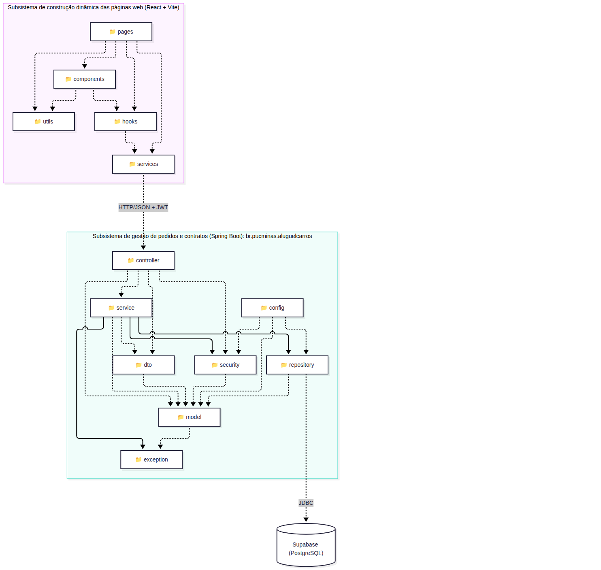</a> | <a href="./docs/uml/v1/casos-de-uso.md">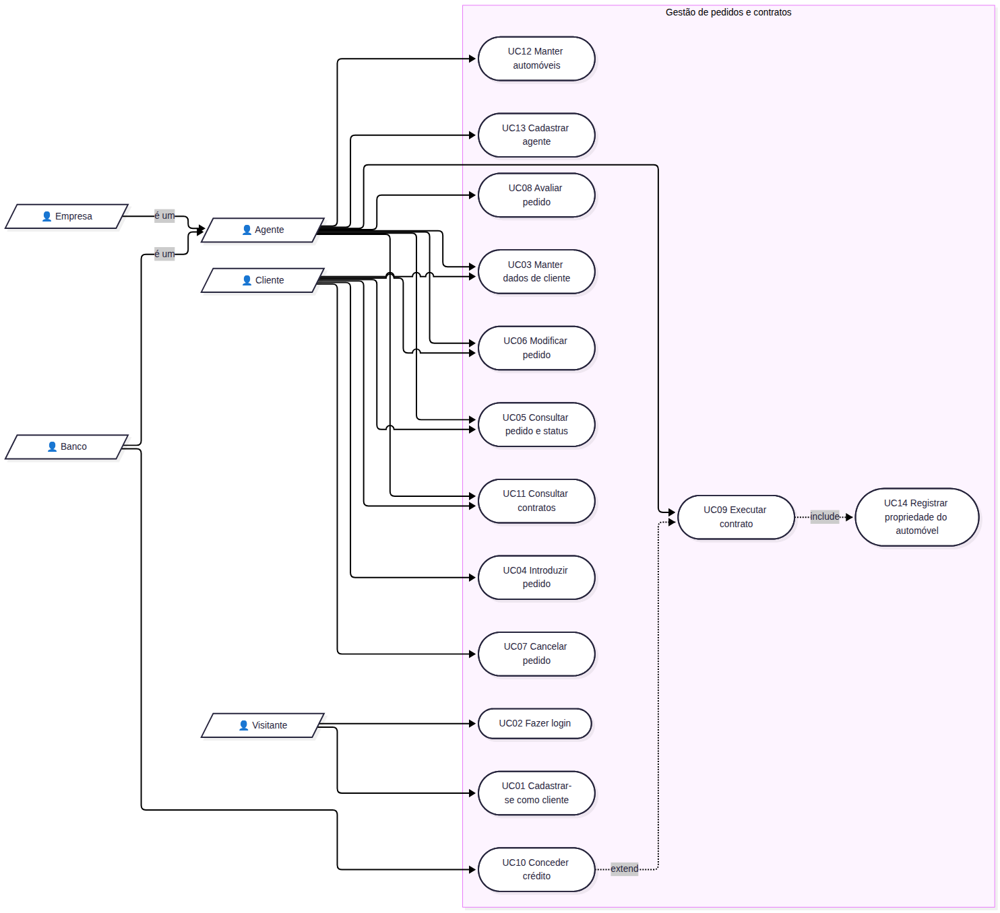</a> |
| **Diagrama de Classes** | **Ciclo de Vida do Pedido** |
| <a href="./docs/uml/v1/classes.md">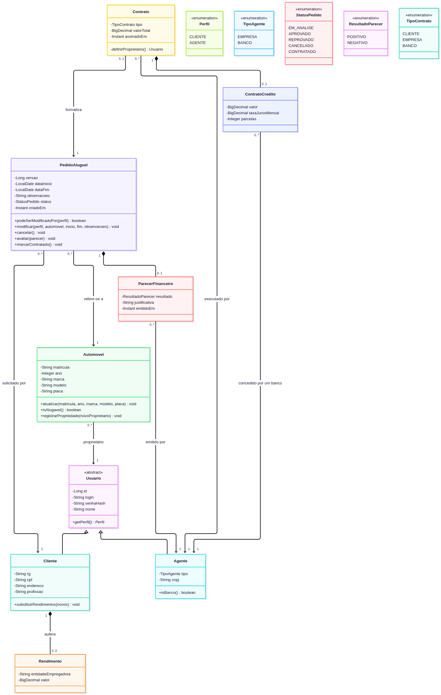</a> | <a href="./docs/uml/README.md">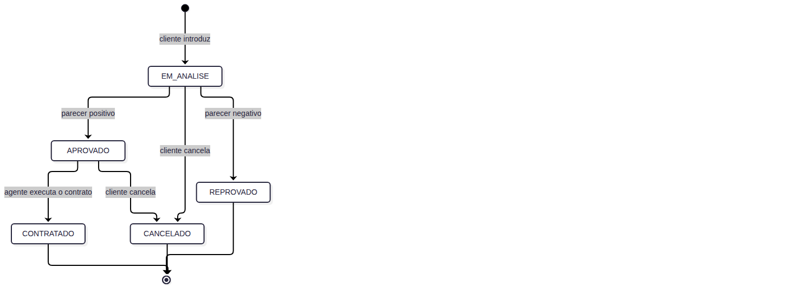</a> |

### API REST

Todas as rotas começam com `/api` e exigem o header `Authorization: Bearer <token>`, exceto o login e o cadastro de cliente.

| Método e rota | Acesso | Descrição |
| :--- | :--- | :--- |
| `POST /auth/login` | Público | Autentica e devolve o token |
| `GET /auth/me` | Autenticado | Dados do usuário atual |
| `POST /clientes` | Público | Cadastra um cliente |
| `GET /clientes` | Agente | Lista os clientes |
| `GET`, `PUT`, `DELETE /clientes/{id}` | Agente ou o próprio cliente | Consulta, altera e exclui |
| `GET`, `POST /agentes` | Agente | Lista e cadastra agentes |
| `GET /automoveis` | Autenticado | Lista automóveis (`?alugaveis=true` filtra os disponíveis) |
| `POST /automoveis` | Agente | Cadastra um automóvel |
| `PUT`, `DELETE /automoveis/{id}` | Agente proprietário | Altera e exclui |
| `POST /pedidos` | Cliente | Introduz um pedido |
| `GET /pedidos`, `GET /pedidos/{id}` | Autenticado (o cliente vê só os dele) | Consulta pedidos |
| `PUT /pedidos/{id}` | Cliente dono ou agente | Modifica um pedido |
| `POST /pedidos/{id}/cancelar` | Cliente dono | Cancela um pedido |
| `POST /pedidos/{id}/avaliar` | Agente | Emite o parecer financeiro |
| `POST /pedidos/{id}/contrato` | Agente | Executa o contrato |
| `GET /pedidos/{id}/contrato` | Autenticado (o cliente vê só os dele) | Consulta o contrato do pedido |
| `GET /contratos` | Autenticado (o cliente vê só os dele) | Lista contratos |

---

## 🔧 Instalação e Execução

### Pré-requisitos

* **Java JDK:** Versão **25** (Necessário para o **Back-end Spring Boot**)
* **Node.js:** Versão 20 ou superior (Necessário para o **Front-end React**)
* **Gerenciador de Pacotes:** npm
* **Banco de Dados:** um projeto no [Supabase](https://supabase.com/) ou **Docker** para um PostgreSQL local
* **Docker** (Opcional, para executar tudo em containers)

O Maven não precisa ser instalado: o projeto inclui o Maven Wrapper (`./mvnw`).

---

### 🔑 Variáveis de Ambiente

#### 1 Back-end (Spring Boot)

Copie `backend/.env.example` para `backend/.env` e preencha os valores. O arquivo `.env` não é versionado.

| Variável | Descrição | Exemplo |
| :--- | :--- | :--- |
| `SERVER_PORT` | Porta do Back-end (opcional, o padrão é 8080). | `8080` |
| `DB_URL` | URL de conexão JDBC (PostgreSQL). | `jdbc:postgresql://aws-0-REGIAO.pooler.supabase.com:5432/postgres?sslmode=require` |
| `DB_USERNAME` | Usuário do banco de dados. | `postgres.REF_DO_PROJETO` |
| `DB_PASSWORD` | Senha do banco de dados. | `SENHA_DO_BANCO` |
| `JWT_SECRET` | Chave de assinatura dos tokens, com 32 caracteres ou mais. Gere com `openssl rand -base64 48`. | `TROQUE_POR_UM_SEGREDO_ALEATORIO` |
| `CORS_ALLOWED_ORIGINS` | Origens autorizadas a chamar a API, separadas por vírgula. | `http://localhost:5173` |
| `APP_SEED_ENABLED` | Com `true`, cria os agentes e automóveis de demonstração na primeira execução. | `true` |
| `APP_SEED_SENHA` | Senha dos agentes de demonstração, com 8 caracteres ou mais. | `TROQUE_POR_UMA_SENHA` |

Os dados de conexão ficam no painel do Supabase, em **Connect > Session pooler**.

#### 2 Front-end (React, Vite)

Nenhuma variável é necessária em desenvolvimento, pois o Vite encaminha `/api` para `localhost:8080`. Em produção, crie `frontend/.env` a partir de `frontend/.env.example`.

| Variável | Descrição | Exemplo |
| :--- | :--- | :--- |
| `VITE_API_URL` | Endereço do Back-end, sem o sufixo `/api`. | `https://minha-api.exemplo.com` |

> **Obs:** As variáveis de ambiente em projetos **Vite** precisam começar com `VITE_` para que o Vite as reconheça e as inclua no *bundle* do frontend.

---

#### 3 Variáveis de Ambiente na Vercel

O projeto ainda não foi publicado. Se o Front-end for hospedado na Vercel, adicione `VITE_API_URL` em **Project Settings > Environment Variables**:

```
VITE_API_URL=https://minha-api.exemplo.com
```

As variáveis do Back-end não entram na Vercel: elas ficam no serviço que hospedar a API.

### 📦 Instalação de Dependências

1.  **Clone o Repositório:**

```bash
git clone https://github.com/ThiagoOliveiraJ/LAB_DIAW_02.git
cd LAB_DIAW_02
```

2.  **Instale as Dependências (Monorepo):**

#### Front-end (React)

```bash
cd frontend
npm install
cd ..
```

#### Back-end (Spring Boot)

```bash
cd backend
./mvnw clean install -DskipTests
cd ..
```

---

### 💾 Inicialização do Banco de Dados (PostgreSQL)

O banco principal é o **Supabase**. Depois de preencher `backend/.env`, basta iniciar o Back-end: o **Flyway** cria o schema `aluguel` e as tabelas automaticamente. Nenhuma ação manual é necessária. Para vê-las no **Table Editor** do Supabase, selecione o schema `aluguel`.

Para desenvolver sem o Supabase, suba apenas o PostgreSQL local e use estes valores em `backend/.env`:

```bash
docker compose --profile banco-local up -d db
```

```properties
DB_URL=jdbc:postgresql://localhost:5433/aluguel
DB_USERNAME=aluguel
DB_PASSWORD=aluguel
```

---

### ⚡ Como Executar a Aplicação
Execute a aplicação em modo de desenvolvimento em **dois terminais separados**.

#### Terminal 1: Back-end (Spring Boot)

```bash
cd backend
./mvnw spring-boot:run
```
🚀 *O Back-end estará disponível em **http://localhost:8080**.*

---

#### Terminal 2: Front-end (React, Vite)

```bash
cd frontend
npm run dev
```
🎨 *O Front-end estará disponível em **http://localhost:5173**.*

Com `APP_SEED_ENABLED=true`, a primeira execução cria três automóveis e dois agentes, ambos com a senha definida em `APP_SEED_SENHA`:

| Usuário | Perfil |
| :--- | :--- |
| `locadora` | Agente (empresa): Locadora Horizonte |
| `banco` | Agente (banco): Banco Aliança |

Os clientes se cadastram pela tela de login, em **Cadastre-se como cliente**.

---

#### 🐳 Execução Local Completa com Docker Compose

O `docker-compose.yml` cria os containers do Back-end (**Spring Boot**) e do Front-end (**React** servido pelo **Nginx**). O banco é o **Supabase** configurado em `backend/.env`. Um **PostgreSQL** local fica disponível como opção, no perfil `banco-local`.

---

#### 📦 Passos para build, inicialização e execução

1. Na raiz do projeto, crie `backend/.env` a partir de `backend/.env.example` e preencha os valores.

2. Suba os serviços:

```bash
docker compose up --build -d
```

Para usar o PostgreSQL local em vez do Supabase, defina em `backend/.env`:

```properties
DB_URL=jdbc:postgresql://db:5432/aluguel
DB_USERNAME=aluguel
DB_PASSWORD=aluguel
```

E suba os serviços com o perfil:

```bash
docker compose --profile banco-local up --build -d
```

3. Verifique se os containers estão rodando:

```bash
docker compose ps
```

4. As migrações rodam na inicialização do Back-end. Para confirmar a conclusão, veja os logs:

```bash
docker compose logs backend
```

5. Abra <http://localhost:5173> no navegador. O Nginx encaminha as chamadas de `/api` para o Back-end.

6. Para parar e remover os containers (o volume com os dados do banco local é mantido):

```bash
docker compose --profile banco-local down
```

---

## 🚀 Deploy

O projeto ainda não foi publicado. Para colocá-lo em produção:

1.  **Build do Projeto:**

```bash
cd frontend
npm run build

cd ../backend
./mvnw clean package
```

2.  **Configuração do Ambiente de Produção:** Defina as variáveis do Back-end no serviço que hospedar a API, incluindo em `CORS_ALLOWED_ORIGINS` o endereço do Front-end. Defina `VITE_API_URL` antes do build do Front-end.

3.  **Execução em Produção:**

```bash
java -jar backend/target/aluguel-carros-1.0.0.jar

npx serve -s frontend/dist
```

---

## 📂 Estrutura de Pastas

```
.
├── .gitignore                     # 🧹 Ignora .env, node_modules, target e dist.
├── README.md                      # 📘 Documentação principal do projeto.
├── template_README.md             # 📝 Template da disciplina preenchido (mesmo conteúdo do README).
├── LICENSE                        # ⚖️ Licença do projeto.
├── docker-compose.yml             # 🐳 Orquestração dos containers (front/back/db).
│
├── /frontend                      # 📁 Aplicação React
│   ├── .env.example               # 🧩 Variáveis de ambiente do Front-end.
│   ├── Dockerfile                 # 🐳 Docker build do Front-end.
│   ├── nginx.conf                 # 🌐 Serve o front-end e encaminha /api.
│   ├── vite.config.js             # ⚙️ Porta e proxy para a API.
│   ├── /public                    # 📂 Arquivos estáticos (logo).
│   ├── /src                       # 📂 Código-fonte React
│   │   ├── /components            # 🧱 Componentes reutilizáveis (UI).
│   │   ├── /pages                 # 📄 Páginas/rotas da aplicação.
│   │   ├── /services              # 🔌 Chamadas HTTP.
│   │   ├── /hooks                 # 🎣 Autenticação e carregamento de dados.
│   │   ├── /styles                # 🎨 Estilos globais.
│   │   └── /utils                 # 🛠️ Formatação e rótulos.
│   ├── package.json               # 📦 Dependências e scripts.
│   └── package-lock.json          # 🔒 Lockfile das dependências.
│
├── /backend                       # 📁 Aplicação Spring Boot
│   ├── .env.example               # 🧩 Variáveis de ambiente do Back-end.
│   ├── Dockerfile                 # 🐳 Docker build do Back-end.
│   ├── /src/main/java             # 📂 Código-fonte Java
│   │   └── /br/pucminas/aluguelcarros
│   │       ├── /controller        # 🎮 Endpoints REST.
│   │       ├── /service           # ⚙️ Regras e lógica de negócio.
│   │       ├── /repository        # 🗄️ Repositórios (JPA/Hibernate).
│   │       ├── /model             # 🧬 Entidades persistentes (JPA).
│   │       ├── /dto               # ✉️ Data Transfer Objects.
│   │       ├── /config            # 🔧 Segurança, CORS e carga inicial.
│   │       ├── /exception         # 💥 Exceptions e handler global.
│   │       └── /security          # 🛡️ Geração e leitura do token.
│   ├── /src/main/resources        # 📂 Recursos do Spring Boot
│   │   ├── application.yml        # ⚙️ Configuração principal da aplicação.
│   │   └── /db/migration          # 📜 Migrações do banco (Flyway).
│   ├── /src/test                  # 🧪 Testes de integração.
│   └── pom.xml                    # 🛠️ Build e dependências.
│
└── /docs                          # 📚 Documentação
    ├── historias-de-usuario.md    # 📝 Histórias de usuário.
    ├── /screenshots               # 🖼️ Telas do sistema.
    └── /uml                       # 📐 Modelos UML por versão.
        ├── README.md              # 🧭 Versões, decisões e ciclo do pedido.
        └── /v1                    # Casos de uso, classes e pacotes.
```

---

## 🎥 Demonstração

### 📱 Aplicativo Mobile

Não se aplica: não há aplicativo nativo. A aplicação web se adapta à tela do celular:

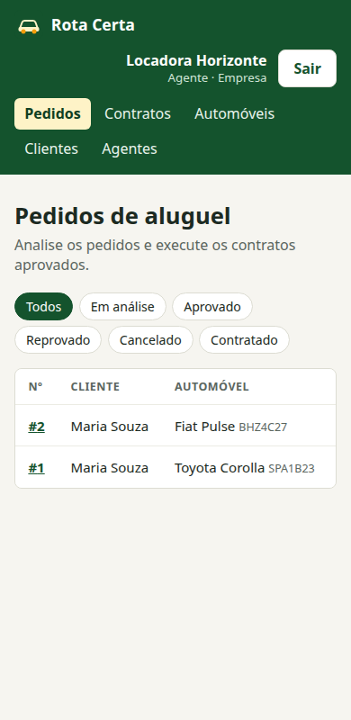

### 🌐 Aplicação Web

Para melhor visualização, as telas principais estão organizadas lado a lado.

| Tela | Captura de Tela |
| :---: | :---: |
| **Pedidos do Cliente (Home)** | **Página de Login** |
| 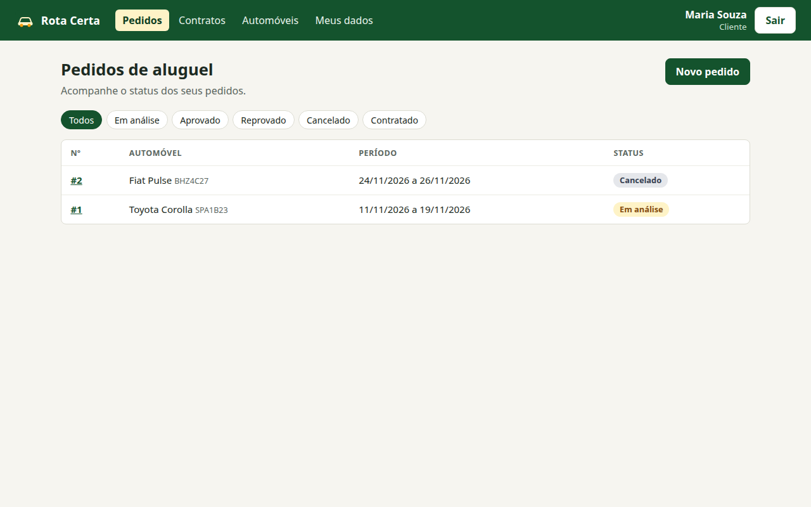 | 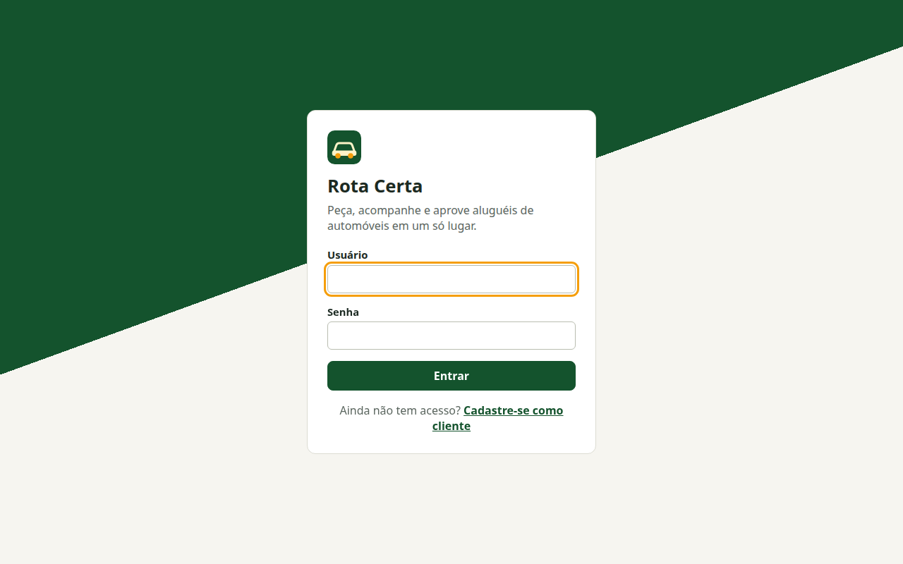 |
| **Cadastro de Clientes** | **Cadastro de Automóveis** |
| 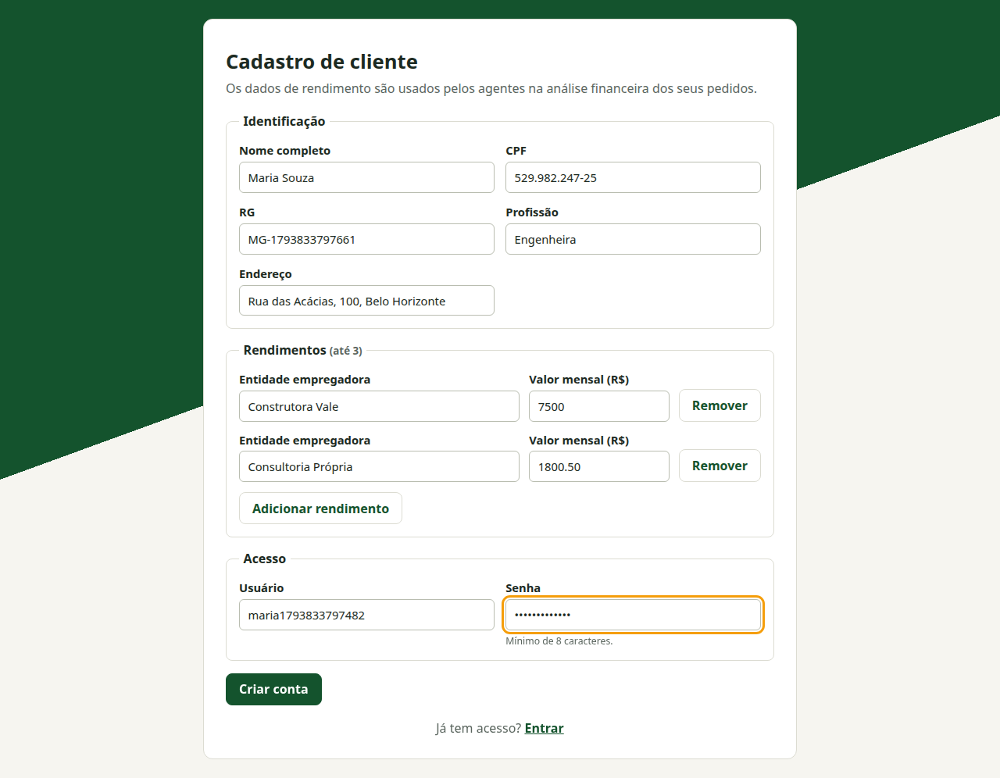 | 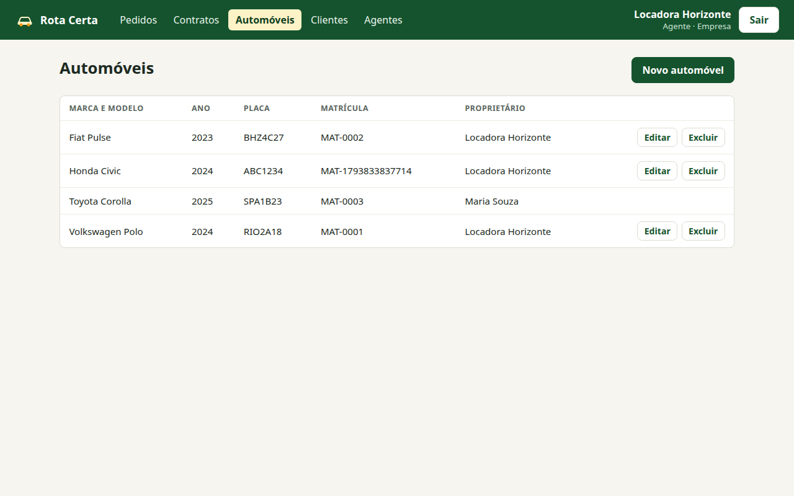 |
| **Novo Pedido** | **Análise Financeira (Agente)** |
| 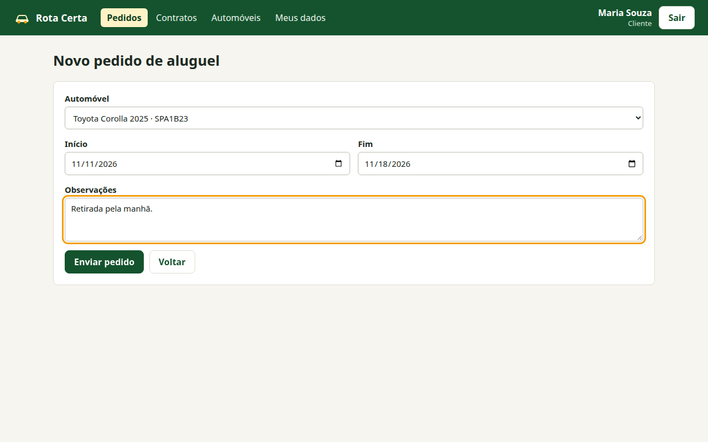 | 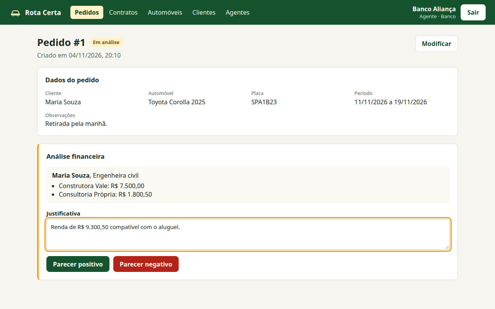 |
| **Pedido com Contrato** | **Contratos** |
| 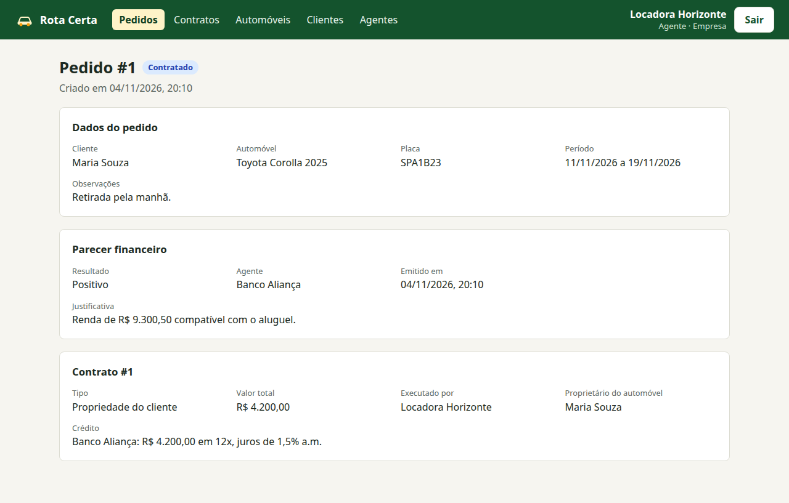 | 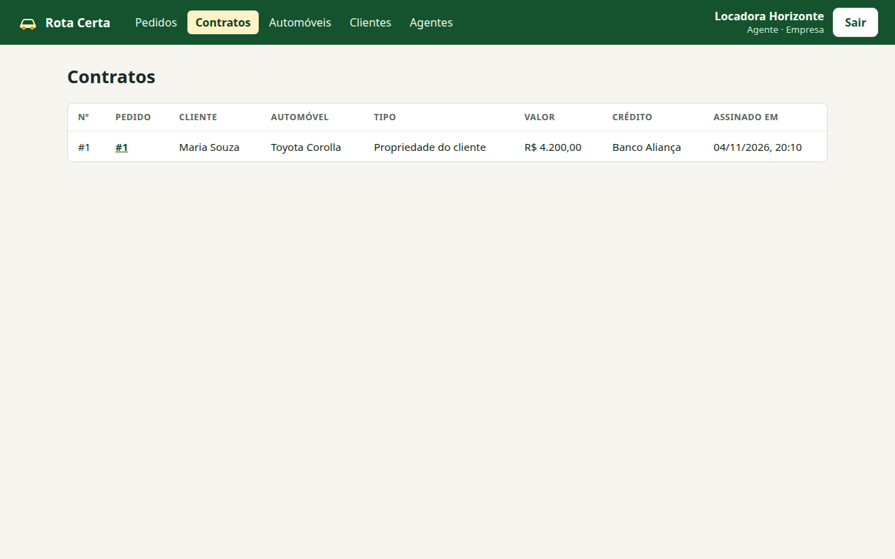 |
| **Pedidos (Agente)** | **Clientes (Agente)** |
| 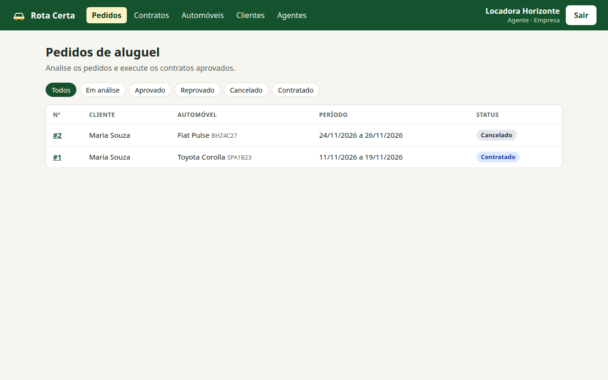 | 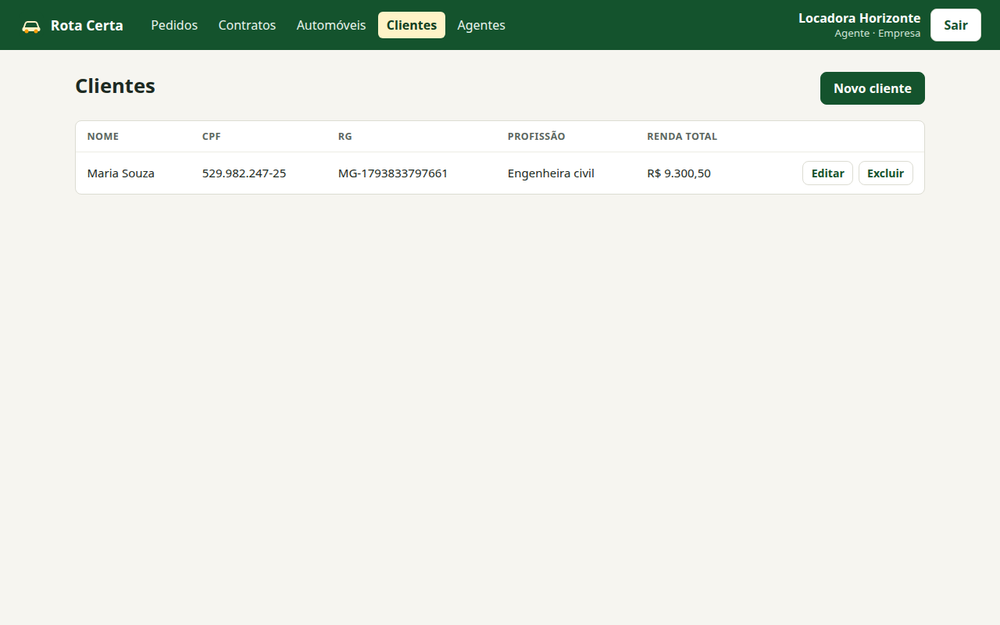 |

### 💻 Exemplo de Saída no Terminal (para Back-end, API, CLI)

#### 1. Demonstração da API (Exemplo com cURL)

Lista os agentes com um token obtido em `POST /api/auth/login`:

```bash
curl -X GET 'http://localhost:8080/api/agentes' \
     -H 'Authorization: Bearer <seu-jwt-token>'
```

**Saída Esperada:**
```json
[
  {
    "id": 2,
    "nome": "Banco Aliança",
    "login": "banco",
    "tipo": "BANCO",
    "cnpj": "11444777000161"
  },
  {
    "id": 1,
    "nome": "Locadora Horizonte",
    "login": "locadora",
    "tipo": "EMPRESA",
    "cnpj": "11222333000181"
  }
]
```

---

#### 2. Demonstração de Execução de CLI/Script

Executa os testes de integração do Back-end:

```bash
cd backend
./mvnw test
```

**Saída Esperada:**
```text
[INFO] Tests run: 13, Failures: 0, Errors: 0, Skipped: 0
[INFO] BUILD SUCCESS
```

---

## 🧪 Testes

### Testes Unitários e de Integração
Para rodar os testes de integração:

```
cd backend
./mvnw test
```
*Ferramentas utilizadas: JUnit 5, MockMvc e H2 em modo PostgreSQL.*

Os testes percorrem a API com as migrações reais do Flyway e cobrem login, CRUD de cliente, permissões, ciclo de vida do pedido, crédito, transferência de propriedade e períodos sobrepostos.

### Testes End-to-End (E2E)
O repositório não tem uma suíte E2E. O fluxo completo, do cadastro do cliente ao contrato, foi verificado manualmente no navegador.

---

## 🔗 Documentações utilizadas

* 📖 **Framework/Biblioteca (Front-end):** [Documentação Oficial do **React**](https://react.dev/reference/react)
* 📖 **Build Tool (Front-end):** [Guia de Configuração do **Vite**](https://vitejs.dev/config/)
* 📖 **Framework (Back-end):** [Documentação Oficial do **Spring Boot**](https://docs.spring.io/spring-boot/)
* 📖 **Banco de Dados:** [Documentação do **Supabase**](https://supabase.com/docs)
* 📖 **Containerização:** [Documentação de Referência do **Docker**](https://docs.docker.com/)
* 📖 **Diagramas:** [Documentação do **Mermaid**](https://mermaid.js.org/)
* 📖 **Guia de Estilo:** [**Conventional Commits** (Padrão de Mensagens)](https://www.conventionalcommits.org/en/v1.0.0/)

---

## 👥 Autores

| 👤 Nome | 🖼️ Foto | :octocat: GitHub | 💼 LinkedIn | 📤 Gmail |
|---------|----------|-----------------|-------------|-----------|
| Thiago Oliveira | <div align="center"></div> | <div align="center"><a href="https://github.com/ThiagoOliveiraJ"></a></div> | | |

---

## 🤝 Contribuição

1.  Faça um `fork` do projeto.
2.  Crie uma branch para sua feature (`git checkout -b feature/minha-feature`).
3.  Commit suas mudanças (`git commit -m 'feat: Adiciona nova funcionalidade X'`). **(Utilize [Conventional Commits](https://www.conventionalcommits.org/en/v1.0.0/))**
4.  Faça o `push` para a branch (`git push origin feature/minha-feature`).
5.  Abra um **Pull Request (PR)**.

---

## 🙏 Agradecimentos

* [**Engenharia de Software PUC Minas**](https://www.instagram.com/engsoftwarepucminas/) - Pelo apoio institucional e pela estrutura acadêmica.
* [**Prof. Dr. João Paulo Aramuni**](https://github.com/joaopauloaramuni) - Pela orientação na disciplina e pelo template deste README.

---

## 📄 Licença

Este projeto é distribuído sob a **[Licença MIT](./LICENSE)**.

---
