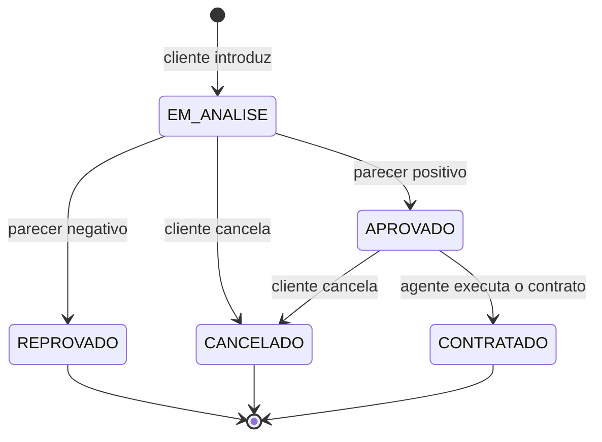

# Modelos UML

Os diagramas estão em [Mermaid](https://mermaid.js.org/), que o GitHub exibe direto no Markdown, com uma imagem `.png` exportada ao lado de cada um. Cada revisão fica em uma pasta própria, para manter todas as versões produzidas no repositório, como pede o enunciado.

| Versão | Conteúdo | Situação |
| :---: | :--- | :--- |
| [`v1`](./v1) | [Casos de uso](./v1/casos-de-uso.md), [classes](./v1/classes.md) e [pacotes](./v1/pacotes.md) | Alinhada ao código atual |

## Como registrar uma revisão

1. Copie `v1` para `v2` e altere os diagramas conforme o feedback recebido em aula.
2. Acrescente uma linha na tabela acima dizendo o que mudou e por quê.
3. Ajuste o código para continuar alinhado ao modelo.

## Decisões de modelagem (v1)

O enunciado deixa alguns pontos em aberto. Estas foram as interpretações adotadas:

| Ponto do enunciado | Decisão | Motivo |
| :--- | :--- | :--- |
| Agentes são "empresas e bancos" | Classe única `Agente` com `TipoAgente` | Os dois têm os mesmos dados e permissões; só o banco concede crédito, regra validada em `ContratoCredito` |
| "Matrícula" e "placa" do automóvel | Campos distintos, ambos únicos | O enunciado lista os dois; a matrícula é tratada como código de registro do veículo |
| Propriedade "depende do tipo de contrato" | `TipoContrato` define o novo proprietário: `CLIENTE`, `EMPRESA` (quem executa) ou `BANCO` (quem concede o crédito) | Torna a regra explícita e verificável |
| Quem cadastra agentes | Um agente existente; os primeiros vêm da carga inicial | Evita que qualquer visitante se registre como banco |
| Quem executa o contrato | Qualquer agente, não apenas o autor do parecer | Permite que um banco faça a análise e uma empresa execute o contrato |
| Quem pode alterar um cliente | O próprio cliente e os agentes | O enunciado pede um CRUD de cliente sem restringir quem o opera |
| Automóvel registrado em nome de cliente | Deixa de aceitar novos pedidos | O automóvel saiu da frota dos agentes |

## Ciclo de vida do pedido

O cliente modifica o pedido apenas em `EM_ANALISE`; o agente, em `EM_ANALISE` e `APROVADO`.
