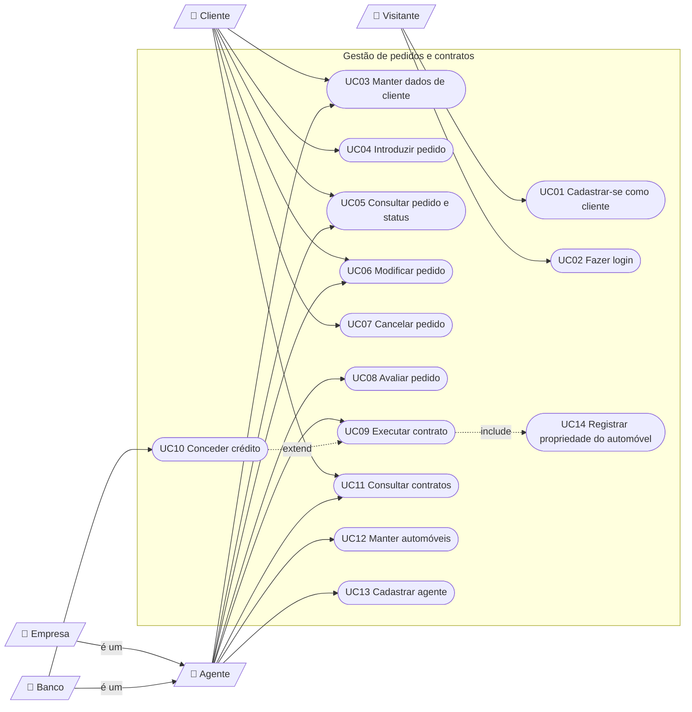

# Diagrama de Casos de Uso (v1)

O Mermaid não tem um tipo próprio para casos de uso. Aqui, os retângulos são atores, as formas arredondadas são casos de uso e as setas pontilhadas com rótulo são `include`/`extend`.

