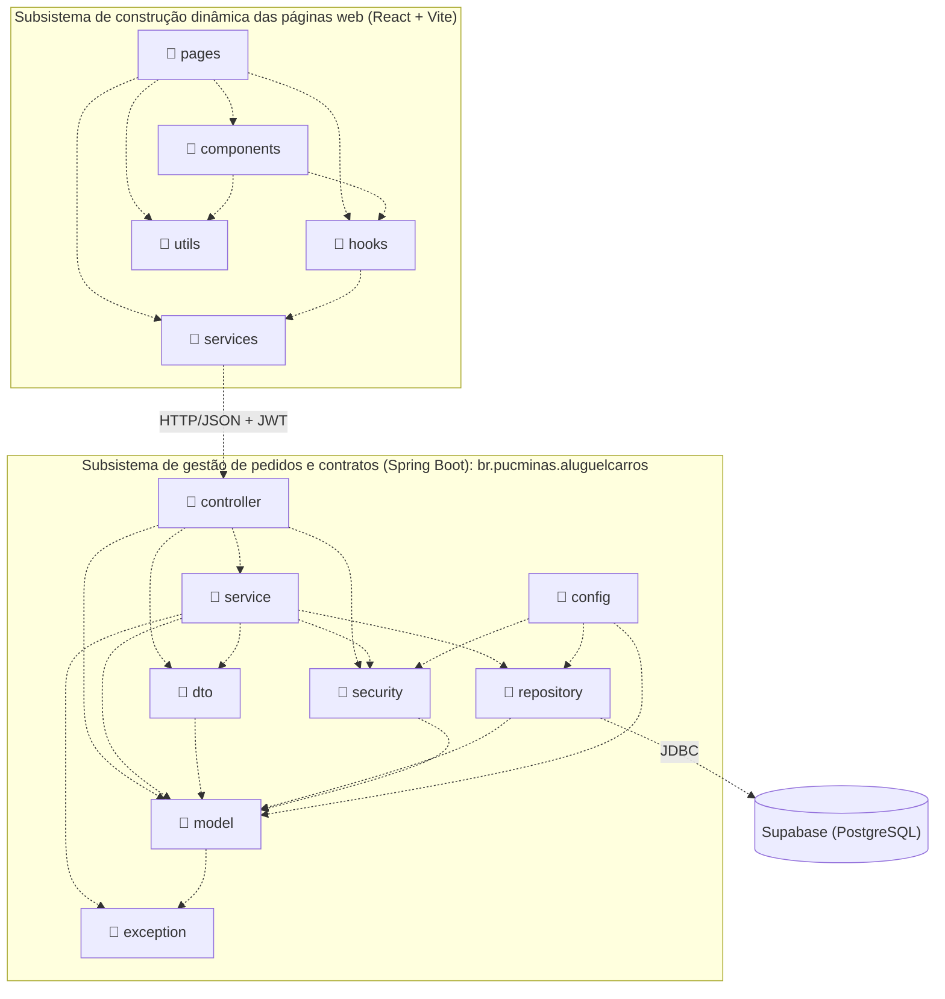

# Diagrama de Pacotes: Visão Lógica (v1)

Cada bloco é um pacote, e as setas pontilhadas são dependências. Os dois blocos externos são os subsistemas pedidos no enunciado. No padrão MVC, o front-end é a **View**, `controller` é o **Controller**, e `service`, `model` e `repository` formam o **Model**.

